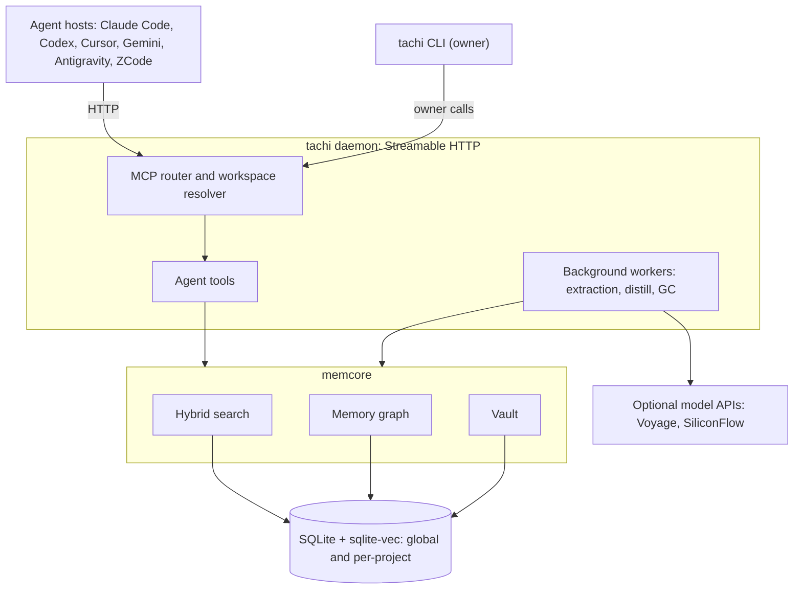

<div align="center">
  
  <h1>✧ Tachi</h1>
  <p><strong>Local-First Memory and Workflow Control Plane for Autonomous AI Agents</strong></p>
  <p>
    <a href="README.md"><b>English</b></a> ·
    <a href="README.zh-CN.md">简体中文</a> ·
    <a href="README.classical.md">文言文</a>
  </p>
  <p>
    <a href="https://www.gnu.org/licenses/agpl-3.0"></a>
    
    
    
    
  </p>
</div>

---

Tachi is a single-binary, local-first memory and coordination backend for AI agents. One resident daemon serves [MCP](https://modelcontextprotocol.io/) over Streamable HTTP, keeps everything in embedded SQLite, and gives every connected agent the same long-term memory, task context, and saved connections.

Named after the Tachikomas from *Ghost in the Shell*: agents that evolve through shared memory.

## Highlights

- **Structured, persistent memory**: hierarchical `path` namespaces, free-text `domain` tags, and causal graph edges between memories, entities, and decisions.
- **Hybrid recall**: semantic (sqlite-vec + Voyage), lexical (FTS5 with CJK tuning), temporal decay, and graph spreading activation, fused with RRF.
- **Workspace-first**: Tachi works out which project a call comes from and searches that project's library before global memory and the shared Wiki.
- **Task briefs and a shared work board**: compact briefings, who is working on what, and whether a task has only finished running or has actually been delivered.
- **Encrypted local Vault**: API keys and OAuth tokens, including those for third-party MCP servers, stay in the Vault and never appear in agent configuration.
- **One MCP connection**: register third-party MCP servers once in Tachi, and agents see their tools through the same Tachi connection.
- **Zero external database**: one Rust binary and one SQLite file per store.

## Release status

- **Current release:** `v2.0.0` (store schema 39). See the [2.0.0 notes](CHANGELOG.md#200---2026-09-25).
- **On `main`, not yet released:** first-party MCP is HTTP-only, the agent entry is a single default profile, and workspace binding, briefings, and CJK recall have improved. See [Unreleased](CHANGELOG.md#unreleased).
- **Upgrading** from 1.9.x, or from a setup that launched Tachi as a stdio subprocess? Read [docs/UPGRADING.md](docs/UPGRADING.md) first.

---

## Quick start

### 1. Install

```bash
brew tap kckylechen1/tachi && brew install tachi
```

Or use the shell installer. The v2.0.0 tag publishes no OpenClaw plugin asset, so pass `--skip-plugin`:

```bash
bash -c "$(curl -fsSL https://raw.githubusercontent.com/kckylechen1/tachi/v2.1.0/scripts/install.sh)" -- --skip-plugin
```

- On macOS the installer also installs and restarts a user LaunchAgent (`~/Library/LaunchAgents/com.kckylechen.tachi.daemon.plist`). Add `--skip-daemon-service` if you only want the binary.
- The tag pipeline ships one prebuilt archive, `tachi-v2.0.0-aarch64-apple-darwin` (Apple Silicon). Other platforms must build from source (unverified).

Verify:

```bash
tachi --version
tachi daemon status
```

### 2. Start the daemon

```sh
tachi --daemon --no-project-db --port 6919 serve
```

First-party Tachi MCP is served **only over HTTP**. Clients never spawn or replace the daemon, and neither bare `tachi` nor `tachi serve` starts an MCP pipe.

### 3. Connect your agent

```json
{
  "mcpServers": {
    "tachi": {
      "type": "http",
      "url": "http://127.0.0.1:6919/mcp",
      "headers": {
        "x-tachi-client": "claude-code",
        "x-tachi-workspace-root": "/absolute/workspace"
      }
    }
  }
}
```

The setup helper writes the right schema for each host. Preview first, then add `--apply` to write a backed-up config:

```bash
python3 scripts/setup_agent_mcp.py --agent claude-code --url http://127.0.0.1:6919/mcp
```

If a host cannot send the workspace header, Tachi can still bind the right library from per-call workspace metadata or MCP Roots. Antigravity uses its native `serverUrl` configuration. Details are in the [HTTP cookbook](docs/engineering/architecture/http-direct-connect.md).

Model keys belong in the daemon's environment or Tachi config, never in client configuration. `VOYAGE_API_KEY` enables semantic search; without it, recall uses lexical and graph search. `SILICONFLOW_API_KEY` enables extraction, summaries, and distillation.

### 4. Use it

The examples below show the JSON arguments passed to the MCP tools. Full schemas live in `crates/tachi-params/src/facade.rs` and its `facade/` submodules.

```json
// Save a structured memory
{
  "tool": "tachi_memory",
  "arguments": {
    "action": "save",
    "text": "Frontend must use Vite, never Webpack. Tailwind is allowed.",
    "path": "/project/frontend",
    "importance": 0.8,
    "keywords": ["vite", "webpack", "tailwind"],
    "retention_policy": "durable"
  }
}

// Hybrid recall
{
  "tool": "tachi_memory",
  "arguments": {
    "action": "search",
    "query": "What is the frontend build policy?",
    "path_prefix": "/project",
    "top_k": 6,
    "scope": "memory"
  }
}

// Feature-scoped briefing before handing bounded work to your host's native subagent
{
  "tool": "tachi_task",
  "arguments": {
    "action": "brief",
    "task": "Review the API boundary and identify compatibility risks."
  }
}
```

Host-specific config paths and advanced setup are in [`docs/INSTALL.md`](docs/INSTALL.md).

---

## Agent tool surface

Connect an ordinary agent without choosing a profile. The default tool list has six entries:

| Tool | Purpose |
|------|---------|
| `tachi_memory` | Search, save, brief, and reuse memory. |
| `tachi_task` | Task briefs, the work board, claims, progress, and completion evidence. |
| `tachi_agent_eval` | Record and inspect bounded native-worker experience. |
| `tachi_staff` | Track external workers under the explicit staffing policy. |
| `tachi_a2a` | Admitted agent-to-agent coordination. |
| `vault_connections` | Read saved connection metadata and prepare host commands without exposing secrets. |

Worker (`delegate`) sessions get `tachi_memory`, `tachi_task`, `tachi_staff`, and `tachi_a2a`, plus read-only `vault_connections`: five tools, no `tachi_agent_eval`, and no recursive staffing. Tools from third-party MCP servers registered in Tachi appear alongside, named `server__tool`, with their upstream schemas and results unchanged.

Hosts that support the MCP Skills extension can load Tachi's usage guide on demand from `skill://tachi/SKILL.md`, which keeps the always-loaded server instructions short.

**Profiles and owner maintenance.** The `standard` spelling still means the default. Existing `observe` and `coordinate` settings keep their action restrictions. Public `operate`/`ops` and `admin`/`emergency` selectors are retired and rejected in CLI, environment, and HTTP metadata. Maintenance goes through supported owner CLI commands, which authenticate each call separately and never widen the agent catalog; their private capability never belongs in client configuration. The raw handlers those commands use remain registered internally as Ops/admin compatibility routes. A smaller public surface does not physically delete them.

---

## Core capabilities

### Memory and recall

Memories live under `path` namespaces such as `/user/preferences` or `/project/architecture`, so project, user, and coordination context stay separate. Every memory carries a free-text `domain` tag that save and search can filter on. Saves can link entries that share entities, and recall's graph channel follows those links.

Recall fuses five channels: semantic KNN, CJK-tuned FTS5 with query expansion, an ACT-R-style forgetting curve, graph spreading activation, and reciprocal rank fusion. Long Chinese queries need proportional phrase coverage, so scattered single-character matches no longer surface as noise.

### Workspace-first libraries

The global store lives at `~/.tachi/global/tachi-memory.db`; each project has its own store at `<git-root>/.tachi/tachi-memory.db`. A call is routed to its workspace from the connection header, per-call workspace metadata, or MCP Roots. Recall checks the project library first, then aggregates global memory and the shared Wiki. Calls from one host in different workspaces stay isolated from each other.

### Briefings, board, and delivery state

`tachi_task` `brief`, `board`, and `status` show the current stage, who is working on what, and recent run receipts. Execution completion is reported separately from durable result delivery. Compact briefs collapse duplicate rosters and filter unrelated history. `tachi_memory` briefings can deliver Wiki knowledge and applicable Guides, then skip bodies the client still holds unchanged, which saves tokens across turns.

### Vault and credentials

Local secret storage uses Argon2id and AES-256-GCM with per-secret nonces, auto-lock, brute-force protection, per-secret agent ACLs, and key rotation.

- Agents discover scoped API and SSH connections through read-only `vault_connections`. `tachi vault connection run NAME -- <cmd>` injects declared credentials or invokes the registered SSH alias.
- Project bindings use `.tachi/vault.env` with `tachi env run`.
- Third-party MCP servers are configured directly in each host; Hub stores only retained `skill` and `plugin` definitions.

See [Vault connections](docs/engineering/architecture/vault-connections.md).

### Continuity and project lifecycle

Tachi records typed project events, turns repeated behavior into reusable pattern memories, labels outcomes, and links issues, PRs, docs, Wiki pages, and run artifacts. Future agents can then pick up a project cycle without rebuilding it from chat history. GitHub is a read-only source for intake and status.

Design docs: [continuity memory](docs/engineering/architecture/tachi-continuity-memory-architecture.md) · [project-cycle spine](docs/engineering/architecture/project-cycle-memory-spine.md) · [pattern timeline](docs/engineering/architecture/pattern-timeline-bonding-memory.md)

### Portable memory kernel

`portable-kernel` is the Cargo facade over `memcore` with Tachi's admin features disabled; `portable-server` exposes it without linking Tachi's operator surfaces. The kernel also supports host-defined, immutable typed records. Owner ruling #1195 keeps these packages as candidate boundaries for a future ZeroClaw-native memory module, but no direct ZeroClaw Cargo integration has landed. The [kernel manifest](docs/engineering/architecture/kernel-surface-v1.fixture.json) freezes the durable schema, recall primitives, and readiness diagnostics as a product-agnostic contract.

---

## Architecture



| Path | What it is |
|------|------------|
| `crates/memcore` | Storage, migrations, hybrid search, graph, Vault metadata, sqlite-vec. |
| `crates/tachi-server` | MCP server and daemon: routing, workspace binding, briefings, Hub, dispatch, Wiki, background workers. |
| `crates/tachi-params` | Typed tool parameters and facade schemas. |
| `crates/tachi-hub` | Hub capability policy and Skill visibility rules. |
| `crates/tachi-bootstrap` | CLI command contract and startup parsing. |
| `crates/portable-kernel`, `crates/portable-server` | Portable memory kernel without Tachi's operator surfaces. |
| `crates/memory-node` | Node.js bindings (`@chaoxlabs/tachi-node`). |
| `tools/` | Utilities such as `tachi-clean` and recall evaluation. |
| `scripts/` | Installer, agent setup helper, and release checks. |
| `docs/` | Install and upgrade guides, architecture, and engineering docs. |
| `integrations/openclaw` | Retired OpenClaw plugin: migration notes and historical release notes only. |

---

## Configuration

Copy `.env.example` to `.env` in your project root. The server loads it automatically.

```bash
# Semantic search (lexical and graph recall work without it)
VOYAGE_API_KEY=your_voyage_key_here

# Recommended: extraction, summaries and distillation
SILICONFLOW_API_KEY=your_siliconflow_key_here
SILICONFLOW_BASE_URL=https://api.siliconflow.cn/v1/chat/completions
SILICONFLOW_MODEL=Qwen/Qwen3.5-27B

# Optional: override the global DB path
MEMORY_DB_PATH=~/.tachi/global/tachi-memory.db
```

Background extraction, summaries, and daily distillation call the configured OpenAI-compatible API lanes, try a configured fallback provider, and record `LANE_OUTAGE` when the chain is exhausted. Ordinary reasoning tries Claude CLI first, then the configured API. Per-lane overrides (`EXTRACT_*`, `DISTILL_*`, `SUMMARY_*`, `REASONING_*`) are documented in `.env.example`.

| Variable | Purpose |
|----------|---------|
| `TACHI_HOME` | Tachi home directory (default `~/.tachi`); the global DB path follows it. |
| `TACHI_PROFILE` | Optional compatibility restriction for existing read or worker setups. Leave unset normally. Retired Ops/admin selectors refuse startup. |
| `GH_TOKEN` | Read-only GitHub issue and PR snapshots for intake and status. |
| `TACHI_ACP_APPROVAL_MODE` | `automatic` (default) or `interactive` Native ACP read/search confirmation. |
| `TACHI_BYPASS_MANIFEST` | `1` skips the manifest global-DB write guard at startup, for development or crash recovery. |

### Database safety

Tachi uses SQLite in WAL mode. Breaking these rules can corrupt a store:

| Rule | Why |
|------|-----|
| One writer per DB | The daemon holds an exclusive lock (`tachi-memory.db.lock`). |
| No cloud-synced paths | iCloud, Dropbox, OneDrive, and Google Drive are incompatible with SQLite WAL. |
| No raw writes while running | Read-only `sqlite3` queries are safe; INSERT/UPDATE are not. |
| Graceful shutdown | The daemon handles SIGINT/SIGTERM and runs `PRAGMA optimize`. Avoid `kill -9`. |

Sync encrypted bundles, event logs, Vault ciphertext, and Wiki/Skill artifacts rather than live SQLite files.

---

## Local development

```bash
cargo build --release

# CI runs nextest; a test that passes only on retry counts as a failure
cargo nextest run --workspace

# Run the daemon from source
cargo run -p tachi-server -- --daemon --port 6919 serve
```

Requires Rust ≥ 1.75. Coding agents follow the [repository contract](AGENTS.md); [CLAUDE.md](CLAUDE.md) only adapts it for Claude.

---

## Documentation

| Topic | Where |
|-------|-------|
| Installation and host configs | [docs/INSTALL.md](docs/INSTALL.md) |
| Upgrading and migration | [docs/UPGRADING.md](docs/UPGRADING.md) |
| Release notes | [CHANGELOG.md](CHANGELOG.md) |
| HTTP connection cookbook | [http-direct-connect.md](docs/engineering/architecture/http-direct-connect.md) |
| Vault connections | [vault-connections.md](docs/engineering/architecture/vault-connections.md) |
| Delivery and review procedure | [dispatch-lifecycle.md](docs/engineering/architecture/dispatch-lifecycle.md) |
| Issue governance | [issue-portfolio-governance.md](docs/engineering/architecture/issue-portfolio-governance.md) |

The auto-generated [workspace documents index](docs/_index.md) is a navigation snapshot, **not** proof that a feature is live.

---

## How Tachi compares

Tachi is not a general-purpose vector database or a managed memory cloud. It is a local-first coordination backend for agents that speak MCP.

| Dimension | Tachi | Mem0 | Letta | Chroma | Raw vector DB |
|---|---|---|---|---|---|
| **Integration** | MCP server (Streamable HTTP) | Language SDKs | Python SDK + ADE | HTTP API + SDKs | None |
| **Deployment** | Single Rust binary | Library + optional service | Service + frontend | Service + optional Cloud | Depends |
| **Storage** | Local SQLite + sqlite-vec | Usually PG / Redis / vector DB | PG + Qdrant / Chroma | Chroma index | Various |
| **External dependencies** | Zero (embedding provider optional) | Medium | Medium | Low to medium | High |
| **Data locality** | Local-first | Cloud-first, self-hostable | Self-hosted | Self-hosted / Cloud | Depends |
| **Memory organization** | `path` hierarchy + causal graph + domain | Entity + session | Agent state + memory blocks | Collection + metadata | None |
| **Workflow control** | Task briefs, work board, staffing | None | Agent orchestration | None | None |
| **Target user** | Individuals and small teams running autonomous agents | App developers adding memory | Builders of stateful agents | Systems needing vector search | Infrastructure engineers |

---

## Acknowledgements

- **[LongMem](https://github.com/Victorwz/LongMem)** (NeurIPS 2023): decoupled memory architecture; influenced dual-DB isolation.
- **[gbrain](https://github.com/garrytan/gbrain)**: brain-vs-memory layering; influenced namespaces, global/project isolation, and background GC.
- **[ENGRAM](https://arxiv.org/abs/2511.12960)**: typed memory categories and dense retrieval; validated the hybrid search direction.
- **[Karpathy's LLM Wiki](https://gist.github.com/karpathy/442a6bf555914893e9891c11519de94f)**: LLM-maintained structured wiki pages; inspired the Tachi Wiki.

---

## Contributing

**Tachi is currently not accepting external contributions.** The project has a single maintainer and copyright holder; outside pull requests are closed automatically by `.github/workflows/close-external-prs.yml`. See [CONTRIBUTING.md](CONTRIBUTING.md). You are welcome to use, fork, and study Tachi under AGPL-3.0-only.

## License

Tachi is licensed under the [GNU Affero General Public License v3.0 only](LICENSE).

Copyright © 2026 Kyle Chen. All rights reserved where not granted under the AGPL-3.0-only license.
