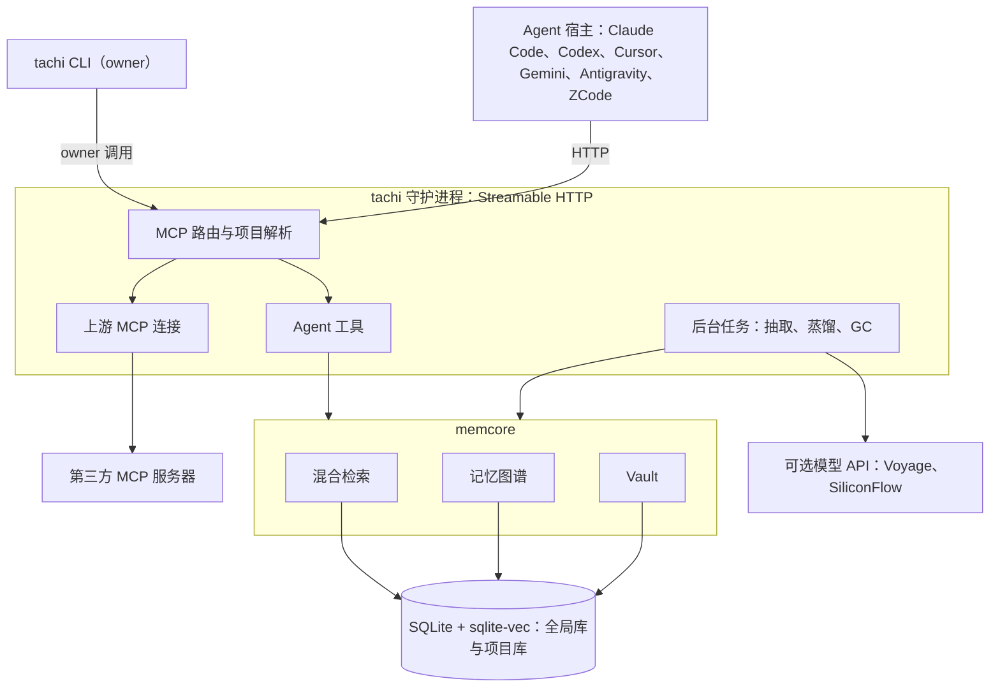

<div align="center">
  
  <h1>✧ 藏经阁（Tachi）</h1>
  <p><strong>面向自主 AI Agent 的本地优先记忆与工作流控制平面</strong></p>
  <p>
    <a href="README.md">English</a> ·
    <a href="README.zh-CN.md"><b>简体中文</b></a> ·
    <a href="README.classical.md">文言文</a>
  </p>
  <p>
    <a href="https://www.gnu.org/licenses/agpl-3.0"></a>
    
    
    
    
  </p>
</div>

---

Tachi 是一个单二进制、本地优先的 AI Agent 记忆与协调后端。它以一个常驻守护进程的形式，通过 Streamable HTTP 提供 [MCP](https://modelcontextprotocol.io/) 服务，所有数据都存放在嵌入式 SQLite 中。每个接入的 Agent 共享同一份长期记忆、任务上下文和已保存的连接。

名字取自《攻壳机动队》中的塔奇克马：通过共享记忆不断进化的 AI 单元。

## 亮点

- **结构化的持久记忆**：层级 `path` 命名空间、自由文本 `domain` 标签，以及连接记忆、实体和决策的因果图谱边。
- **混合检索**：语义（sqlite-vec + Voyage）、词法（针对中文优化的 FTS5）、时间衰减和图谱激活蔓延，通过 RRF 融合。
- **项目优先**：Tachi 能识别每次调用来自哪个项目，先查该项目的记忆库，再查全局记忆和共享 Wiki。
- **任务简报与共享看板**：紧凑的简报、谁在做什么，以及任务是“跑完了”还是“结果真正交付了”。
- **本地加密保险库**：API Key 和 OAuth 令牌（包括第三方 MCP 服务器的）都保存在 Vault 中，不会出现在 Agent 配置里。
- **一个 MCP 连接**：第三方 MCP 服务器只需在 Tachi 注册一次，Agent 通过同一个 Tachi 连接就能看到它们的工具。
- **无需外部数据库**：一个 Rust 二进制，每个库一个 SQLite 文件。

## 发布状态

- **当前版本：** `v2.0.0`（存储 schema 39）。见 [2.0.0 发布说明](CHANGELOG.md#200---2026-09-25)。
- **`main` 上尚未发布的变化：** 一方 MCP 只走 HTTP，Agent 入口统一为一个默认配置，项目绑定、简报和中文召回都有改进。见 [Unreleased](CHANGELOG.md#unreleased)。
- **升级提示：** 从 1.9.x 升级，或者以前是让客户端以 stdio 子进程方式启动 Tachi，请先阅读 [docs/UPGRADING.md](docs/UPGRADING.md)（英文）。

---

## 快速开始

### 1. 安装

```bash
brew tap kckylechen1/tachi && brew install tachi
```

或者使用 shell 安装脚本。v2.0.0 标签不发布 OpenClaw 插件资产，因此需要加 `--skip-plugin`：

```bash
bash -c "$(curl -fsSL https://raw.githubusercontent.com/kckylechen1/tachi/v2.0.0/scripts/install.sh)" -- --skip-plugin
```

- 在 macOS 上，安装脚本还会安装并重启用户级 LaunchAgent（`~/Library/LaunchAgents/com.kckylechen.tachi.daemon.plist`）。只想要二进制的话，加 `--skip-daemon-service`。
- 标签流水线只提供一个预编译包 `tachi-v2.0.0-aarch64-apple-darwin`（Apple Silicon）。其他平台需要从源码编译（未经验证）。

验证：

```bash
tachi --version
tachi daemon status
```

### 2. 启动守护进程

```sh
tachi --daemon --no-project-db --port 6919 serve
```

Tachi 的一方 MCP **只通过 HTTP 提供**。客户端不会启动或替换守护进程；单独运行 `tachi` 或 `tachi serve` 都不会开启 MCP 管道。

### 3. 接入 Agent

```json
{
  "mcpServers": {
    "tachi": {
      "type": "http",
      "url": "http://127.0.0.1:6919/mcp",
      "headers": {
        "x-tachi-client": "claude-code",
        "x-tachi-workspace-root": "/absolute/workspace"
      }
    }
  }
}
```

配置助手会为每个宿主生成正确的格式。先预览，确认后加 `--apply` 写入（会自动备份原配置）：

```bash
python3 scripts/setup_agent_mcp.py --agent claude-code --url http://127.0.0.1:6919/mcp
```

如果宿主无法发送项目路径请求头，Tachi 也能根据每次调用附带的项目元数据或 MCP Roots 绑定正确的记忆库。Antigravity 使用其原生的 `serverUrl` 配置。详见 [HTTP 接入手册](docs/engineering/architecture/http-direct-connect.md)。

模型密钥只配置在守护进程的环境变量或 Tachi 配置中，不要写进客户端配置。`VOYAGE_API_KEY` 启用语义检索，没有它时召回使用词法和图谱检索。`SILICONFLOW_API_KEY` 启用事实抽取、摘要和蒸馏。

### 4. 使用

下面是传给 MCP 工具的 JSON 参数示例。完整 schema 见 `crates/tachi-params/src/facade.rs` 及其 `facade/` 子模块。

```json
// 保存结构化记忆
{
  "tool": "tachi_memory",
  "arguments": {
    "action": "save",
    "text": "前端必须使用 Vite，禁止 Webpack，允许 Tailwind。",
    "path": "/project/frontend",
    "importance": 0.8,
    "keywords": ["vite", "webpack", "tailwind"],
    "retention_policy": "durable"
  }
}

// 混合召回
{
  "tool": "tachi_memory",
  "arguments": {
    "action": "search",
    "query": "前端构建规范是什么？",
    "path_prefix": "/project",
    "top_k": 6,
    "scope": "memory"
  }
}

// 先获取功能简报，再把边界清晰的工作交给宿主原生的子 Agent
{
  "tool": "tachi_task",
  "arguments": {
    "action": "brief",
    "task": "审查 API 边界，找出兼容性风险。"
  }
}
```

各宿主的配置路径与高级设置见 [`docs/INSTALL.md`](docs/INSTALL.md)。

---

## Agent 工具面

普通 Agent 接入时无需选择配置，默认工具列表共六项：

| 工具 | 用途 |
|------|------|
| `tachi_memory` | 检索、保存、简报与复用记忆。 |
| `tachi_task` | 任务简报、工作看板、认领、进度与完成证据。 |
| `tachi_agent_eval` | 记录并查看原生 Worker 的有限经验。 |
| `tachi_staff` | 按显式的人员调度策略追踪外部 Worker。 |
| `tachi_a2a` | 经准入的 Agent 间协作。 |
| `vault_connections` | 读取已保存的连接元数据，并在不暴露密钥的前提下准备宿主命令。 |

Worker（`delegate`）会话拿到 `tachi_memory`、`tachi_task`、`tachi_staff`、`tachi_a2a` 和只读的 `vault_connections`，共五个工具：不含 `tachi_agent_eval`，也不能递归派遣。在 Tachi 注册的第三方 MCP 服务器的工具会以 `server__tool` 的名字一并出现，上游的 schema 和返回结果保持不变。

支持 MCP Skills 扩展的宿主可以从 `skill://tachi/SKILL.md` 按需加载 Tachi 的使用指南，这样常驻的服务器说明就能保持简短。

**配置与维护。** `standard` 这个旧写法仍然等同于默认配置；现有的 `observe` 和 `coordinate` 设置保留各自的动作限制。公开的 `operate`/`ops`、`admin`/`emergency` 选择器已经退役，CLI、环境变量和 HTTP 元数据都会拒绝它们。维护操作请使用受支持的 owner CLI 命令：每次调用都单独鉴权，不会扩大 Agent 能看到的工具目录，其私有凭据也不应写进客户端配置。这些命令用到的原始 handler 仍作为内部的 Ops/admin 兼容路由保留注册；公开工具面变小，并不代表它们被物理删除。

---

## 核心能力

### 记忆与召回

记忆存放在 `/user/preferences`、`/project/architecture` 这样的 `path` 命名空间下，项目、用户和协作上下文互不干扰。每条记忆都带一个自由文本 `domain` 标签，保存和检索时都可以按它过滤。保存时可以自动把共享实体的记忆连接起来，召回的图谱通道会沿着这些连接扩散。

召回融合五个通道：语义 KNN、带查询扩展的中文优化 FTS5、ACT-R 风格的遗忘曲线、图谱激活蔓延，以及倒数排名融合（RRF）。长中文查询需要足够比例的词组覆盖才会命中，零散的单字匹配不再作为噪音出现。

### 项目优先的记忆库

全局库位于 `~/.tachi/global/tachi-memory.db`，每个项目有自己的库 `<git-root>/.tachi/tachi-memory.db`。每次调用会根据连接请求头、调用附带的项目元数据或 MCP Roots 路由到对应项目。召回先查项目库，再汇总全局记忆和共享 Wiki。同一个宿主在不同项目中的调用互相隔离。

### 简报、看板与交付状态

`tachi_task` 的 `brief`、`board`、`status` 会显示当前阶段、谁在做什么，以及最近的运行回执。“执行完成”和“结果已持久交付”分开显示。紧凑简报会合并重复的名单，过滤无关的历史条目。`tachi_memory` 的简报可以附带 Wiki 知识和适用的 Guide，并跳过客户端仍然持有且未变化的正文，跨轮对话更省 token。

### Vault 与 MCP 连接

本地密钥存储使用 Argon2id + AES-256-GCM，逐条随机数、自动上锁、防暴力破解、逐条 Agent ACL，并支持多密钥轮换。

- Agent 通过只读的 `vault_connections` 发现有权使用的 API 和 SSH 连接。`tachi vault connection run NAME -- <cmd>` 会注入声明的凭据，或调用已注册的 SSH 别名。
- 项目绑定使用 `.tachi/vault.env` 配合 `tachi env run`。
- 第三方 MCP 服务器通过 owner 的 `tachi hub ...` 命令注册一次。它们的 API Key 和 OAuth 令牌都存放在 Vault 中，公共客户端 OAuth 由 `tachi mcp login` 完成。

详见 [Vault 连接说明](docs/engineering/architecture/vault-connections.md)。

### 连续性与项目生命周期

Tachi 记录类型化的项目事件，把重复出现的行为沉淀为可复用的模式记忆，标注结果，并把 issue、PR、文档、Wiki 页面和运行产物关联起来。之后接手的 Agent 不必从聊天记录重建上下文，就能延续同一个项目周期。GitHub 只作为 intake 和状态的只读来源。

设计文档：[连续性记忆](docs/engineering/architecture/tachi-continuity-memory-architecture.md) · [项目周期主干](docs/engineering/architecture/project-cycle-memory-spine.md) · [模式时间线](docs/engineering/architecture/pattern-timeline-bonding-memory.md)

### 可移植记忆内核

`portable-kernel` 是基于 `memcore`、关闭了 Tachi 管理功能的 Cargo 门面；`portable-server` 在不链接 Tachi 运维面的前提下对外提供它。内核还支持由宿主定义的不可变类型化记录。按 owner 裁定 #1195，这些包保留为将来 ZeroClaw 原生记忆模块的候选边界，但目前还没有直接的 ZeroClaw Cargo 集成。[内核清单](docs/engineering/architecture/kernel-surface-v1.fixture.json) 把持久 schema、召回原语和就绪诊断冻结为与产品无关的契约。

---

## 架构



| 路径 | 说明 |
|------|------|
| `crates/memcore` | 存储、迁移、混合检索、图谱、Vault 元数据、sqlite-vec。 |
| `crates/tachi-server` | MCP 服务器与守护进程：路由、项目绑定、简报、Hub、派遣、Wiki、后台任务。 |
| `crates/tachi-params` | 类型化的工具参数与门面 schema。 |
| `crates/tachi-hub` | Hub 能力策略与 Skill 可见性规则。 |
| `crates/tachi-bootstrap` | CLI 命令契约与启动解析。 |
| `crates/portable-kernel`、`crates/portable-server` | 不含 Tachi 运维面的可移植记忆内核。 |
| `crates/memory-node` | Node.js 绑定（`@chaoxlabs/tachi-node`）。 |
| `tools/` | `tachi-clean`、召回评测等工具。 |
| `scripts/` | 安装脚本、Agent 配置助手、发布检查。 |
| `docs/` | 安装与升级指南、架构与工程文档。 |
| `integrations/openclaw` | 已退役的 OpenClaw 插件：仅保留迁移说明和历史发布记录。 |

---

## 配置

把 `.env.example` 复制为项目根目录下的 `.env`，服务器会自动加载。

```bash
# 语义检索（没有它，词法与图谱召回仍可用）
VOYAGE_API_KEY=your_voyage_key_here

# 推荐：事实抽取、摘要与蒸馏
SILICONFLOW_API_KEY=your_siliconflow_key_here
SILICONFLOW_BASE_URL=https://api.siliconflow.cn/v1/chat/completions
SILICONFLOW_MODEL=Qwen/Qwen3.5-27B

# 可选：覆盖全局库路径
MEMORY_DB_PATH=~/.tachi/global/tachi-memory.db
```

后台抽取、摘要和每日蒸馏走配置好的 OpenAI 兼容 API 通道，失败时先尝试配置的备用 provider，整条链路耗尽才记录 `LANE_OUTAGE`。普通推理先试 Claude CLI，再转配置的 API。各通道的覆盖项（`EXTRACT_*`、`DISTILL_*`、`SUMMARY_*`、`REASONING_*`）见 `.env.example`。

| 变量 | 用途 |
|------|------|
| `TACHI_HOME` | Tachi 主目录（默认 `~/.tachi`），全局库路径随之变化。 |
| `TACHI_PROFILE` | 现有只读或 Worker 配置的可选兼容限制，通常不用设置。已退役的 Ops/admin 选择器会导致启动被拒绝。 |
| `GH_TOKEN` | 用于 intake 与状态的只读 GitHub issue/PR 快照。 |
| `TACHI_ACP_APPROVAL_MODE` | `automatic`（默认）或 `interactive`，控制 Native ACP 读取/搜索确认。 |
| `TACHI_BYPASS_MANIFEST` | 设为 `1` 时跳过启动时的全局库写保护，用于开发或崩溃恢复。 |

### 数据库安全

Tachi 以 WAL 模式使用 SQLite，违反以下规则可能损坏数据库：

| 规则 | 原因 |
|------|------|
| 每个库只能有一个写入者 | 守护进程持有排他锁（`tachi-memory.db.lock`）。 |
| 不要放在云同步目录 | iCloud、Dropbox、OneDrive、Google Drive 与 SQLite WAL 不兼容。 |
| 运行时不要直接写库 | 只读的 `sqlite3` 查询是安全的，INSERT/UPDATE 不安全。 |
| 优雅关闭 | 守护进程会处理 SIGINT/SIGTERM 并执行 `PRAGMA optimize`，避免 `kill -9`。 |

需要同步时，同步加密 bundle、事件日志、Vault 密文和 Wiki/Skill 产物，而不是正在使用的 SQLite 文件。

---

## 本地开发

```bash
cargo build --release

# CI 使用 nextest；重试后才通过的测试视为失败
cargo nextest run --workspace

# 从源码运行守护进程
cargo run -p tachi-server -- --daemon --port 6919 serve
```

需要 Rust ≥ 1.75。编码 Agent 遵循[仓库契约](AGENTS.md)；[CLAUDE.md](CLAUDE.md) 只是针对 Claude 的补充适配。

---

## 文档导航

| 主题 | 位置 |
|------|------|
| 安装与宿主配置 | [docs/INSTALL.md](docs/INSTALL.md) |
| 升级与迁移 | [docs/UPGRADING.md](docs/UPGRADING.md) |
| 发布说明 | [CHANGELOG.md](CHANGELOG.md) |
| HTTP 接入手册 | [http-direct-connect.md](docs/engineering/architecture/http-direct-connect.md) |
| Vault 连接 | [vault-connections.md](docs/engineering/architecture/vault-connections.md) |
| 交付与审阅流程 | [dispatch-lifecycle.md](docs/engineering/architecture/dispatch-lifecycle.md) |
| Issue 治理 | [issue-portfolio-governance.md](docs/engineering/architecture/issue-portfolio-governance.md) |

自动生成的[工作区文档索引](docs/_index.md)只是导航快照，**不能**证明其中描述的功能已经上线。

---

## 与同类方案对比

Tachi 不是通用向量数据库，也不是托管记忆云服务，而是面向 MCP Agent 的本地优先协调后端。

| 维度 | Tachi | Mem0 | Letta | Chroma | 裸向量库 |
|---|---|---|---|---|---|
| **接入方式** | MCP 服务器（Streamable HTTP） | 多语言 SDK | Python SDK + ADE | HTTP API + SDK | 无 |
| **部署** | 单个 Rust 二进制 | 库 + 可选服务 | 服务 + 前端 | 服务 + 可选云 | 视情况 |
| **存储** | 本地 SQLite + sqlite-vec | 通常是 PG / Redis / 向量库 | PG + Qdrant / Chroma | Chroma 索引 | 多种 |
| **外部依赖** | 无（embedding 服务可选） | 中 | 中 | 低到中 | 高 |
| **数据位置** | 本地优先 | 云优先，可自托管 | 自托管 | 自托管 / 云 | 视情况 |
| **记忆组织** | `path` 层级 + 因果图谱 + domain | 实体 + 会话 | Agent 状态 + 记忆块 | 集合 + 元数据 | 无 |
| **工作流控制** | 任务简报、工作看板、人员调度 | 无 | Agent 编排 | 无 | 无 |
| **目标用户** | 运行自主 Agent 的个人和小团队 | 给应用加记忆的开发者 | 构建有状态 Agent 的开发者 | 需要向量检索的系统 | 基础设施工程师 |

---

## 致谢

- **[LongMem](https://github.com/Victorwz/LongMem)**（NeurIPS 2023）：解耦的记忆架构，影响了双库隔离设计。
- **[gbrain](https://github.com/garrytan/gbrain)**：大脑与记忆的分层，影响了命名空间、全局/项目隔离和后台 GC。
- **[ENGRAM](https://arxiv.org/abs/2511.12960)**：类型化记忆分类与稠密检索，验证了混合检索的方向。
- **[Karpathy's LLM Wiki](https://gist.github.com/karpathy/442a6bf555914893e9891c11519de94f)**：由 LLM 维护的结构化 Wiki 页面，启发了 Tachi Wiki。

---

## 贡献

**Tachi 目前不接受外部贡献。** 项目只有一位维护者和版权持有人，外部 PR 会被 `.github/workflows/close-external-prs.yml` 自动关闭。详见 [CONTRIBUTING.md](CONTRIBUTING.md)。欢迎在 AGPL-3.0-only 条款下使用、fork 和研究 Tachi。

## 许可证

Tachi 采用 [GNU Affero General Public License v3.0 only](LICENSE) 授权。

Copyright © 2026 Kyle Chen。AGPL-3.0-only 未授予的权利均予保留。
