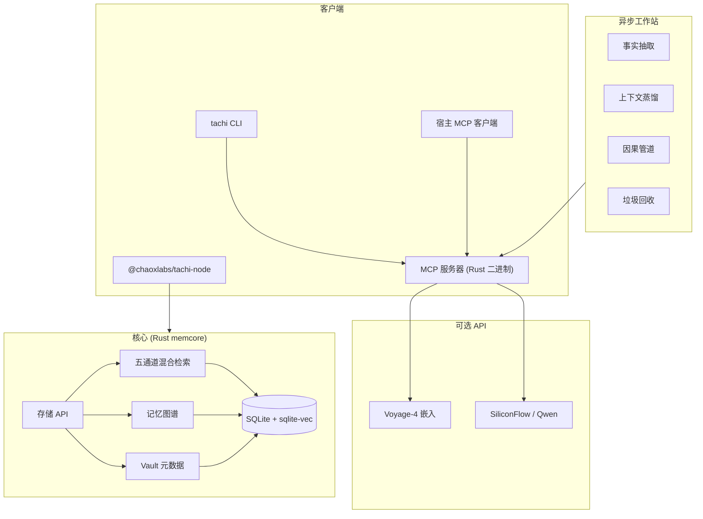

<div align="center">
  
  <h1>✧ 藏经阁（Tachi）</h1>
  <p><strong>面向自主 AI Agent 的本地优先记忆与工作流控制平面</strong></p>
  <p>
    <a href="README.md">English</a> ·
    <a href="README.zh-CN.md"><b>简体中文</b></a> ·
    <a href="README.classical.md">文言文</a>
  </p>
  <p>
    <a href="https://www.gnu.org/licenses/agpl-3.0"></a>
    
    
    
    
  </p>
</div>

---

## 一句话介绍

Tachi 是一个单二进制、本地优先的 Agent 记忆与协调后端。它以 [MCP](https://modelcontextprotocol.io/) 服务器形态（`tachi-server`）运行，为 Agent 提供：

- **持久记忆**，支持混合语义 + 词法 + 图谱检索
- **层级命名空间**（`/user/preferences`、`/project/architecture`）
- **因果图谱边**，连接记忆、实体与决策
- **域标签存储**——每条记忆自带自由文本 `domain` 字段，`tachi_memory(action="save")`/`tachi_memory(action="search")` 可按域过滤
- **本地加密保险库**，用于 API 密钥与机密
- **Agent 协调**：交接令牌、看板、发布订阅（幽灵低语）
- **技能包与能力中心**：一次注册，各 Agent 共用
- **五大产品门面**：`tachi_memory`、`tachi_task`、`tachi_agent_eval`、`tachi_staff`、`tachi_a2a`（`tachi_gh` 已于 2026-10-22 退役）
- **API/SSH 连接目录**：通过只读 `vault_connections` 发现连接，再由 CLI 注入指定 Key 或调用系统 SSH。见 [Vault 连接说明](docs/engineering/architecture/vault-connections.md)。

所有状态都存储在嵌入式 SQLite 中。**无需任何外部数据库。**

名字取自《攻壳机动队》中的塔奇克马：通过共享记忆不断进化的 AI 单元。

### 文档入口与权威来源

编码 Agent 应以根目录 [AGENTS.md](AGENTS.md) 为共同规则；
[CLAUDE.md](CLAUDE.md) 只补充 Claude 专用适配。开发、独立审阅及验收
应查阅[交付与审阅流程](docs/engineering/architecture/dispatch-lifecycle.md)；
Issue 归属与关闭规则以
[Issue 治理契约](docs/engineering/architecture/issue-portfolio-governance.md)
为准。运行时升级或数据库迁移前应查阅 [安装手册](docs/INSTALL.md)。

自动生成的[工作区文档索引](docs/_index.md)只是导航快照，并不证明
其中描述的功能已经部署。旧 Tachi Shell 资料已分别进入
[产品状态档案](docs/archive/product-tachi-shell/status.md)和
[决策历史档案](docs/archive/tachi-shell/decisions.md)。
该索引应由现有文档整理器重新生成，不要人工维护第二套权威清单。

### 当前发布

当前版本：`v2.0.0`。这是一次大版本升级：移除了部分公开 MCP 路由，磁盘 schema 从 28 升到 39，调用已退役工具的脚本需要先迁移到存留门面。要点：

- v2.0.0 之后 `tachi_gh` 已退役（见 CHANGELOG Unreleased）。当前 Lead 提供五个产品门面和只读 `vault_connections`；Worker（`delegate`）不含 `tachi_agent_eval`，共五个工具入口。
- 已退役的模型面路由从路由器移除，结局各不相同：记忆保存/检索别名与直连看板路由的职能由规范门面承接（`tachi_memory`、`tachi_task` 看板动作）；orchestrator 与技能推荐/进化路由无替代直接移除。记忆管理动作按动作分流：`progress` 转 `tachi_task(action='status')`，`readiness` 转内部 status handler（使用受支持的 `tachi status` CLI），`delete`/`gc`/`doctor_scan` 转运维 CLI（`tachi delete`、`tachi gc` 的 plan|apply 与 `tachi doctor`）；`ingest`/`ingest_source`/`pattern_feedback` 无模型面替代。
- 升级按 [`docs/INSTALL.md` Step 1b](docs/INSTALL.md) 的顺序执行：先停掉实际的服务管理器与所有新旧读写方并防止重启，在替换前备份库目录与旧二进制，再安装新二进制但不启动服务；先以 `tachi migrate --rename-legacy --apply --offline` 单独离线转换旧文件名，再以 `tachi migrate --apply` 升级 schema，逐条核对结果。`--offline` 是操作者声明，不能自动阻止旧二进制重启；回退请用备份。
- 标签流水线只发布 Mac arm64 CLI 与 Homebrew formula；npm 包走独立的手动发布通道，新标签不等于 npm 上已有新版本。
- 绑定项目的普通记忆搜索可在原有结果之外附带 MCP ResourceLink；读取时核对来源、revision、正文摘要和生效时间窗口，返回原正文。全局库、Wiki 和私有分区不在此范围；带角色约束的搜索、已配置或无法读取的 sandbox 策略会禁用此功能，Resource 目录保持为空。

完整迁移说明见 [CHANGELOG.md](CHANGELOG.md)（英文）。

---

## 为什么用 Tachi

如今的 Agent 记忆通常是这样的：每次会话冷启动，重要上下文被塞进扁平向量库，几周后提示窗口里塞满无关碎片，而关键决策背后的"为什么"早已消失。

Tachi 基于四个信念构建：

1. **记忆应该结构化，而不是乱堆。** 层级 `path` 命名空间、因果图谱边和域标签让长期上下文保持有序、可追踪。
2. **检索应该是混合且快速的。** 语义（sqlite-vec + Voyage）、词法（FTS5 + CJK）、时间衰减（ACT-R）和图谱激活蔓延通过 RRF 融合。我们针对本地低延迟查找优化；可复现的基准测试已在路线图中。
3. **Agent 应该共享基础设施，而不是各自 spawn 混乱。** Tachi Hub 一次注册 MCP 服务器和技能，已连接 Agent 共享连接池、空闲清理、熔断器和清洗后的环境。告别僵尸进程。
4. **长期状态应留在本地。** 所有数据库都是 SQLite 文件，无需云数据库。云同步应传输加密 bundle 和事件日志，而不是活的 WAL 文件。

## Tachi 与同类方案对比

Tachi 不是通用向量数据库，也不是托管记忆云服务。它是面向 MCP 智能体的本地优先协调后端。

| 维度 | Tachi | Mem0 | Letta | Chroma | 裸向量库 |
|---|---|---|---|---|---|
| **接入协议** | MCP server（STDIO / Streamable HTTP） | 多语言 SDK | Python SDK + ADE | HTTP API + SDK | 无 |
| **部署形态** | 单 Rust 二进制 | 库 + 可选服务 | 服务 + 前端 | 服务 + 可选 Cloud | 依赖实现 |
| **存储后端** | 本地 SQLite + sqlite-vec | 通常需 PG / Redis / 向量库 | PG + Qdrant / Chroma | Chroma 索引 | 多种 |
| **外部依赖** | 零（embedding provider 可选） | 中等 | 中等 | 低到中 | 高 |
| **默认数据位置** | 本地优先 | 云优先，可自托管 | 自托管 | 自托管 / Cloud | 依赖实现 |
| **记忆组织** | `path` 层级 + 因果图谱 + 域 | Entity + session | Agent 状态 + memory block | Collection + metadata | 无 |
| **工作流控制** | `task` / `staff` / `verify` | 无 | Agent 编排 | 无 | 无 |
| **目标用户** | 个人/小团队运行自主 Agent | 应用开发者集成记忆 | 构建有状态 Agent | 需要向量检索的系统 | 基础设施工程师 |

---

## 快速开始

### 1. 安装

```bash
brew tap kckylechen1/tachi && brew install tachi
```

或使用 shell 安装脚本。v2.0.0 标签未发布 OpenClaw 插件资产，二进制安装需带 `--skip-plugin`：

```bash
bash -c "$(curl -fsSL https://raw.githubusercontent.com/kckylechen1/tachi/v2.0.0/scripts/install.sh)" -- --skip-plugin
```

标签流水线只发布一个预编译包 `tachi-v2.0.0-aarch64-apple-darwin`（Apple Silicon macOS）；其他平台需源码自行编译，发布不作验证。从 1.9.x 升级请按 [`docs/INSTALL.md` Step 1b](docs/INSTALL.md) 的顺序执行：停服务、防重启、备份，然后先离线转换旧文件名，再升级 schema 并逐条核对，最后重启服务。旧 OpenClaw memory adapter 已退役，不能连接当前 Tachi；迁移边界见 [`integrations/openclaw`](integrations/openclaw)。

验证：

```bash
tachi --version
```

终端 CLI 统一使用 Rust `tachi` 二进制。TypeScript `@tachi/cli` 与
`tachi menu` 交互菜单已退役，原菜单操作的替代命令见 [Rust CLI 迁移表](README.md)。
旧 TypeScript 配置 `~/.tachi/config.yaml`、`mcp-servers.yaml` 不会自动迁移或删除，
已有记忆与 Vault 数据保留，Node.js 原生绑定继续保留。旧 OpenClaw 插件仅保留配置和本地辅助代码，Tachi memory 连接已停用。

### 2. 配置你的 Agent

先运行 `tachi --daemon --port 6919 serve`。以下是 Claude Code 的原生 HTTP 配置示例；其他客户端请使用 `scripts/setup_agent_mcp.py` 生成对应格式。普通 Agent 使用统一默认入口，无需选择 Profile：

```json
{
  "mcpServers": {
    "tachi": {
      "type": "http",
      "url": "http://127.0.0.1:6919/mcp"
    }
  }
}
```

模型凭据只配置在常驻 daemon 的环境中，不写入 HTTP 客户端配置。

- `VOYAGE_API_KEY` —— 混合语义检索所需（无此 key 时服务仍可启动，仅提供词法/图谱召回）。
- `SILICONFLOW_API_KEY` —— 结构化抽取、摘要、熔炉蒸馏，建议填写。
- 工作区绑定请使用 `X-Tachi-Workspace-Root` 或 `X-Tachi-Project`；普通连接不需要 `X-Tachi-Profile`。旧配置限制见下方的 [Agent MCP 入口](#agent-mcp-入口)。

服务器启动时还会自动加载项目根目录的 `.env`。将 `.env.example` 复制为 `.env` 以进行项目级配置。

### 3. 使用

以下示例展示传给 MCP 工具的 JSON 参数。门面工具暴露的字段与其底层原生工具一致；完整 schema 见 `crates/tachi-params/src/facade.rs` 及其 `facade/` 子模块。

```json
// tachi_memory(action="save") —— 结构化记忆
{
  "tool": "tachi_memory",
  "arguments": {
    "action": "save",
    "text": "前端必须使用 Vite，严禁 Webpack。允许 Tailwind。",
    "path": "/project/frontend",
    "importance": 0.8,
    "keywords": ["vite", "webpack", "tailwind"],
    "retention_policy": "durable"
  }
}

// tachi_memory —— 混合检索
{
  "tool": "tachi_memory",
  "arguments": {
    "action": "search",
    "query": "前端构建策略是什么？",
    "path_prefix": "/project",
    "top_k": 6,
    "scope": "memory"
  }
}

// tachi_staff —— 显式例外场景下派出可跟踪的外部 worker（普通本地委派仍用宿主原生 subagent）
{
  "tool": "tachi_staff",
  "arguments": {
    "action": "start",
    "task": "审阅 API 边界，并把发现写入 result.md。",
    "staffing_reason": "native_subagent_unavailable"
  }
}

// tachi_staff —— 查询上一步返回的 dispatch_id 的运行状态
{
  "tool": "tachi_staff",
  "arguments": {
    "action": "status",
    "dispatch_id": "<start 返回的 dispatch_id>"
  }
}
```

各宿主对应的配置文件路径和高级设置见 [`docs/INSTALL.md`](docs/INSTALL.md)。

---

## 系统架构



---

## 项目结构

| 路径 | 说明 |
|------|------|
| `crates/memcore` | Rust 核心：SQLite 存储、迁移、混合检索、图谱、域、Vault 元数据、sqlite-vec。 |
| `crates/tachi-server` | MCP/CLI 二进制、Profile 过滤、Hub 路由、派发/工作流工具、Wiki、Vault 加密、守护锁、Foundry 后台任务。 |
| `crates/memory-node` | Node.js 原生绑定（`@chaoxlabs/tachi-node`）。 |
| `tools/cleaner` | `tachi-clean` 清理工具，用于安全的 target / worktree / temp 清理。 |
| `skill/` | 内置技能包：`amp`、`codex`、`superpowers`、`waza`。 |
| `integrations/openclaw` | 已退役 OpenClaw 插件的迁移说明与历史发布记录。 |
| `docs/` | Agent 生态规范、安装指南与工程文档。 |
| `bin/` | 本地编译的发布二进制。 |

---

## 核心能力

### 1. 层级化记忆
记忆以 `path` 命名空间存储（例如 `/user/preferences`、`/project/architecture`、`/handoff/active`），而非平铺索引。项目、用户和协调上下文因此自然隔离且可组合。

### 2. 五通道混合检索
- **语义** —— `sqlite-vec` KNN + Voyage-4 嵌入。
- **词法** —— 针对 CJK 优化的 FTS5（`libsimple`），支持查询扩展（同义词、缩写、短语变体）以提升稀疏语料召回。
- **时间衰减** —— 受 ACT-R 遗忘曲线启发。
- **图谱激活蔓延** —— 沿因果/实体边从种子权重传播；同跳内 noisy-OR 累积，防止密集节点垄断结果。
- **RRF 融合** —— 互惠排名融合汇总各通道，向量余弦再加权，减少高语义查询的排名倒置。

### 3. 因果图谱
图谱引擎创建并遍历因果、时序和实体关系。`tachi_memory(action="save")` 可自动为共享实体的记忆建立链接（`auto_link`）。`add_edge` / `get_edges` / `memory_graph` 是内部 `MemoryStore` 原语，已不在 MCP 曲面上（#757）；Agent 通过 `tachi_memory`(旧名 `tachi_save` 已退役) 自动链接和召回的图谱激活蔓延通道（见上文第 2 节）触达图谱能力——没有独立的图谱遍历动作。

### 4. 域标签存储
每条记忆自带自由文本 `domain` 字段（如 `"code-review"`、`"personal"`）。`tachi_memory(action="save")` 和 `tachi_memory(action="search")` 可按域过滤。不存在独立的域注册表——域只是记忆行上的临时标签，不是需要配置的资源。

### 5. 加密保险库（Vault）
本地优先的密钥存储：Argon2id KDF + AES-256-GCM、每秘独立 nonce、空闲自动上锁、暴力破解保护、按 Secret 的 Agent ACL、多钥轮换。Agent 通过只读 `vault_connections` 发现有权限的 API/SSH 连接，再用 `tachi vault connection run NAME -- <cmd>` 注入声明的凭证或调用已注册 SSH 别名。项目绑定使用 `.tachi/vault.env` 和 `tachi env run`；声明的凭证不可用时，API 运行在启动子进程前失败。Vault 管理由 owner CLI 承担；原始秘密管理 MCP 工具和持久 auth/config 写入适配器已退役。详见 [Vault 连接说明](docs/engineering/architecture/vault-connections.md) 与 [安装指南](docs/INSTALL.md)。

### 6. Tachi Hub 与技能包
Hub 保存可复用的 MCP 定义与文档 Skill，由受支持的 `tachi hub ...` owner CLI 管理。宿主继续使用自己的 MCP 连接和 Skill 加载器。保留的注册、投射与文档读取 handler 属于内部管理实现，不进入普通 Agent 工具列表；旧 `run_skill` 已退役。

### 7. 跨 Agent 协调
- **幽灵低语** —— Agent 间持久化主题发布/订阅（`ghost_publish`、`ghost_subscribe`、`ghost_ack`、`ghost_reflect`、`ghost_promote`）。
- **看板** —— 跨 Agent 卡片，支持 `ack` / `progress` / `result` 状态（旧名 `post_card`/`check_inbox`/`update_card` 已退役——看板经 `tachi_task` 看板动作触达）。
- **交接** —— 会话用 `tachi_a2a(action='respond')` 发送同机 advisory 消息，或用 `tachi_task(action='handoff')` 传递结构化任务。已退役的 `tachi_handoff` 工具已删除。

> 幽灵及残留看板 handler 属于内部兼容实现，不能通过选择 `admin` 公开。普通 Agent 通过 `tachi_a2a` 与 `tachi_task` 协调。

### 8. 工作流控制平面
Tachi 不只是记忆库；它正在演变为 Agent 工程的持久控制平面：

- **`tachi_task`** —— 贯通 issue intake、docs/spec、路由建议、工作账本和 close-loop 写回；普通本地委派使用宿主原生 subagent。
- **`tachi_staff`** —— 显式例外场景（用户明确要求、跨会话持久、跨设备/远程接力、原生 subagent 不可用）下的外部 staffing 出口（`action='start'`/`'status'`），要求填写 typed `staffing_reason`；不是 `standard` Agent 的日常 subagent 入口。
- **验证账本** —— 服务端在 `.tachi/runs/<flow_id>/verification.json` 保存测试与类型检查证据；`tachi_verify` 属于内部工作流，不进入普通 Agent 工具列表。
- **`tachi_gh`** —— 已退役（2026-10-22 随 GitHub 控制代码一并删除）；GitHub 现在只作为 intake 与 status 的只读来源。

### 9. 神经熔炉与 Wiki
- **Foundry** —— 服务端内部的上下文生命周期及 Agent 进化提案，维护使用受支持的 owner CLI。
- **Wiki** —— 持久知识页的内部 handler 和受支持的 owner CLI；普通会话通过 `tachi_memory` 检索可复用知识。

### 10. 便携 Memory Kernel
Tachi 是下游产品（Hypermem 交易适配器、zeroclaw 通用 chat-agent 适配器、RomanBath 前端）的共享 memory kernel，而非让每个产品各自 fork。**便携 kernel manifest**（`docs/engineering/architecture/kernel-surface-v1.fixture.json`）将持久 schema、召回原语、向量/FTS 回退行为和就绪诊断冻结为产品无关的契约——下游适配器无需继承 Tachi 的 GitHub/派发/发布面。启动时运行 manifest 全局 DB 写入防护（WalOrphan 检查）；`TACHI_BYPASS_MANIFEST=1` 可在开发或崩溃恢复时跳过该防护。

---

## Agent MCP 入口

普通 Agent 连接后直接使用统一默认入口，无需选择档位。工具列表固定为六项：

| 工具 | 职责 |
|------|------|
| `tachi_memory` | 检索、保存和复用记忆。 |
| `tachi_task` | 工作上下文、claim、进度与完成证据。 |
| `tachi_agent_eval` | 记录和读取宿主原生 Worker 的有界执行经验。 |
| `tachi_staff` | 在明确的 staffing 策略下跟踪外部 Worker。 |
| `tachi_a2a` | 经过身份准入的 Agent 协作。 |
| `vault_connections` | 读取连接元数据、准备宿主命令，不返回密钥。 |

旧 `standard` 配置继续对应这个默认入口。已有 `observe`、`remember`（动作已退役）、`coordinate` 配置保留原动作限制；旧 `agent` 别名仍表示已退役的 `remember`。Worker 合同继续使用 `delegate`，少一项 `tachi_agent_eval`，共五个工具，并继续拒绝递归派工。这些是内部兼容约束，无需用户在新接入时选择。

公开的 `operate`/`ops`、`admin`/`emergency` 及其 Ops/admin 特权别名已退役，CLI、环境变量和 HTTP 元数据都会拒绝。维护请使用受支持的 owner CLI；其认证请求逐工具限定权限，不公开更大的 Agent 工具目录，也不能把私有能力写入客户端配置。owner CLI 依赖的原始 handler 继续保留在内部，入口收敛不等于物理删除这些实现。

---

## 模型栈

Phase 2 已简化后台 Lane。抽取、摘要和每日蒸馏走配置好的 OpenAI-compatible API lane；已配置的不同 provider 回退耗尽后才显式记录 `LANE_OUTAGE`。`FOUNDRY_DISTILL_BACKEND=claude_cli` 仍是兼容选择器，但实际仍调用 API distill lane，不会启动 Claude 子进程。常规 reasoning/chat 则先尝试 Claude CLI，再回退到配置好的 API；provider-only 调用会刻意跳过 CLI。大多数部署只需：

| 用途 | 是否必填 | 默认值 |
|------|----------|--------|
| 嵌入 | **是** | Voyage-4，通过 `VOYAGE_API_KEY` |
| 抽取 / 摘要 / 蒸馏 | 建议 | SiliconFlow `Qwen/Qwen3.5-27B`，通过 `SILICONFLOW_API_KEY` |

高级场景仍支持按 Lane 覆盖（`EXTRACT_*`、`DISTILL_*`、`SUMMARY_*`、`REASONING_*`），详见 `.env.example`。

---

## 环境变量配置

将 `.env.example` 复制为项目根目录的 `.env`：

```bash
# 必填
VOYAGE_API_KEY=your_voyage_key_here

# 建议
SILICONFLOW_API_KEY=your_siliconflow_key_here
SILICONFLOW_BASE_URL=https://api.siliconflow.cn/v1/chat/completions
SILICONFLOW_MODEL=Qwen/Qwen3.5-27B

# 可选：覆盖全局 DB 路径。默认 ~/.tachi/global/tachi-memory.db；
# 项目库在 <git-root>/.tachi/tachi-memory.db 自动检测。
MEMORY_DB_PATH=~/.tachi/global/tachi-memory.db
```

服务器启动时会自动加载项目根目录的 `.env`。

---

## 数据库安全

Tachi 使用 WAL 模式的 SQLite。违反以下规则可能导致数据库损坏：

| 规则 | 原因 |
|------|------|
| **每个库单一实例** | 服务器持有排他文件锁（`tachi-memory.db.lock`）。同一数据库文件同一时间只应有一个 Tachi 进程写入。 |
| **不要放在云同步目录** | iCloud、Dropbox、OneDrive、Google Drive 与 SQLite WAL 不兼容。数据库请放在 `~/.tachi/` 或本地项目路径。 |
| **不要并发裸写** | 服务器运行时不要用 `sqlite3` 直接 INSERT/UPDATE。只读查询是安全的。 |
| **优雅关闭** | 服务器处理 SIGINT/SIGTERM，退出时执行 `PRAGMA optimize`。避免 `kill -9`。 |

活的 SQLite 文件应留在本地。应同步加密 bundle、append-only 事件日志、Vault 密文、工作流摘要、wiki/skill 产物等。

---

## 本地开发

```bash
# 编译发布二进制
cargo build --release

# 运行全部测试
cargo test --all

# 从源码运行 MCP 服务器，使用默认 Agent 入口
cargo run -p tachi-server -- --daemon --port 6919 serve
```

需要 Rust ≥ 1.75。Node 绑定基于 napi-rs（打包为 `@chaoxlabs/tachi-node`），迭代开发建议安装 `@napi-rs/cli` 和 `cargo-watch`。

---

## 性能基准

可复现的基准测试套件正在整理中。当前设计目标包括：

- **本地优先延迟**：在热 SQLite 上优化至亚 10 ms 查找。
- **混合检索**：融合语义、词法、时间、图谱多种信号。
- **分层上下文**：通过 `L0 → L1 → L2` 压缩减少提示冗余。
- **零外部数据库依赖**：单个 Rust 二进制，每个库一个 SQLite 文件。

---

## 致谢

Tachi 的设计受到以下 Agent 长期记忆领域工作的启发：

- **[LongMem](https://github.com/Victorwz/LongMem)** (NeurIPS 2023) —— 解耦记忆架构；影响双库隔离与缓存长上下文设计。
- **[gbrain](https://github.com/garrytan/gbrain)** —— brain-vs-memory 分层；影响命名空间设计、全局/项目隔离和后台 GC 管道。
- **[ENGRAM](https://arxiv.org/abs/2511.12960)** —— 类型化记忆分类 + 稠密检索；验证混合搜索方向。
- **[Karpathy's LLM Wiki](https://gist.github.com/karpathy/442a6bf555914893e9891c11519de94f)** —— LLM 维护结构化 wiki 页面；直接启发 Tachi Wiki 系统。

---

## 开源协议

[AGPLv3](LICENSE) © 2026 Tachi Authors。
