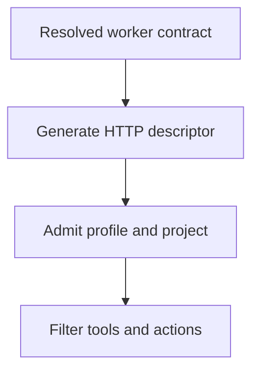

# Facade Granularity & Profile Alignment

This document preserves the facade design analysis. The earlier inventories are
historical; the current profile boundary and Worker wiring are described in
sections 3 and 4. The current setup contract is
[Agent MCP Surface and Internal Policy](./tool-profile-plan.md), alongside
[Kernel Surface V1](./kernel-surface-v1.md).

It answers three questions raised during a facade review:

1. Do our facades expose too many actions, to the point that agents get lost?
2. Should we flatten everything into many single-purpose tools, or keep facades?
3. The `ToolProfile` layer was designed early — is it still doing anything useful?

## Original diagnosis

- Facades are the right idea, but several are **overloaded**. `tachi_task` carries **10 actions**
  (28 before the 4 PR-lifecycle duplicates were removed to `tachi_gh` in #757);
  `tachi_memory` carries **9** actions and `tachi_gh` (removed) carries **19**; its former
  claim/release aliases are retired in #1688 in favor of `tachi_task`.
- Neither extreme (flatten to 100+ tools, or keep stuffing mega-facades) is correct. The fix is
  **re-slicing facades along agent cognitive domains**, keeping each facade at roughly **7±2 actions**.
- The `ToolProfile` bundle system (`observe/remember/coordinate/operate/admin`) is **largely dead**:
  `standard_minimal` / `delegate_minimal` hard-coded allow-lists bypass the bundles for every default path.
- More fundamentally, **facades broke `ToolProfile`'s granularity**. `ToolProfile` filters by *tool
  name*, but a facade hides many capabilities behind one name, so a profile can only allow or deny an
  entire facade — never a single action.
- The `delegate`/worker surface is the clearest victim of this mismatch, and it proves the point.
- `DispatchProfile` (which agent/model to hire) is unrelated and healthy — keep it.

## 1. Historical facade action inventory

| Facade | Actions | Verdict |
| :--- | ---: | :--- |
| `tachi_task` | 10 | Task lifecycle/read actions; PR duplication resolved (#757), route tuning extracted (#1426), closure moved to `tachi_gh` (#1713), and retired actions removed (#1683 C1a, #1712 C1b-1, #1687 C1c) |
| `tachi_memory` | 9 | Contracted in #1689 to search/get/save/briefing/checkpoint/alerts/ask/extract_facts/consolidate; health, maintenance, ingestion, and pattern evidence use their canonical status, operator, adapter, or internal owners. |
| `tachi_gh` (removed) | 19 | GitHub primitives plus PR lifecycle and `close_loop` |
| `tachi_tune` | 8 | Extracted in #1426 — admin/operator only, absent from every profile pattern array |
| `tachi_skill` | 2 | Contracted to pure static `discover` / `run` (#1690) |
| `tachi_wiki` / `tachi_verify` | 4 / 4 | Healthy |

`tachi_skill` and `tachi_wiki` demonstrate that a **medium-grained facade
(~5-7 actions) works well** (the 7-action `tachi_arena` was retired in #1319-D2). The problem is not facades; it is unbounded facades.

### Concrete confusion points

1. **PR lifecycle dual entry (resolved #757).** `link_pr` / `pr_status` / `pr_handoff` / `release_note`
   now live only on `tachi_gh` (removed). The previous `tachi_task` compatibility aliases were deleted so agents
   no longer guess which entry point to call.
2. **`merge` was semantically split, then resolved — the `tachi_task` `merge` action was retired (#1683 C1a).** It used to mean
   local worktree merge, distinct from the removed `tachi_gh(safe_merge)` GitHub PR merge — same word, different
   machine. `tachi_task(merge)` is retired; `tachi_gh(safe_merge)` is now the only `merge` on either facade.
3. **Briefing then appeared in three surfaces** (historical) — `tachi_briefing` (standalone, since retired),
   `tachi_memory(briefing)`, and the feature-scoped `tachi_task(brief)`. `save` is duplicated
   across `tachi_save` (retired shorthand) and `tachi_memory(save)`.
4. **Self-tuning actions were interleaved with execution (resolved #1426).** Eight of the nine —
   `route_simulate` / `proposals` / `review_proposal` / `apply_proposals` (task side) and
   `recall_simulate` / `recall_proposals` / `review_recall_proposal` / `apply_recall_proposals`
   (memory side) — left the daily surfaces for `tachi_tune`. Pattern evidence is now
   accepted only through the context-bound internal completion/close-loop seam; ordinary
   agents cannot submit feedback that changes counters or ranking.

## 2. Flatten vs. facade — pick the middle

- **Flatten to 100+ tools** is exactly what facades were created to avoid. `tool-profile-plan.md`
  explicitly warns against showing "the full admin catalog (100+ tools)". Flattening blows up context
  and paralyzes tool selection.
- **Keep stuffing mega-facades** just relocates the problem: the "which tool?" difficulty becomes a
  "which action?" difficulty *inside* one tool, plus an exploding schema description.

The design rule:

> **One facade = one coherent noun/cognitive domain, action count ≤ ~7±2.**

Today's facades are sliced by *backend module* (the `task` module → one facade). They should be sliced
by the **agent's mental task**.

> **Superseded by #1713.** The proposal below to introduce a separate `tachi_flow` lifecycle facade is
> retained only as historical analysis. #1713 relocated closure to the existing Coordinate-tier
> `tachi_gh(action='close_loop')` (retired by the 2026-10-22 `gh_ops` removal), removed `tachi_workflow`, and kept lifecycle status on `tachi_task`.

```diagram
Now                            Proposed
tachi_task (10) ─────┬──▶ tachi_task    execution core: complete/status/board (3)
                     ├──▶ tachi_gh (removed)      lifecycle closure: close_loop (1) [#1713]
                     ├──▶ tachi_gh (removed)      all PR lifecycle (already isolated, #757)
                     └──▶ tachi_tune    self-tuning: route_simulate/route_proposals/route_review/route_apply (DONE #1426)

tachi_memory (9) ────────▶ search/get/save/briefing/checkpoint/alerts/ask/extract_facts/consolidate
```

`tachi_tune` remains an internal maintenance handler outside ordinary Agent
MCP discovery. Selecting an `admin` profile no longer exposes it; management
uses supported owner CLI commands with explicit per-tool authorization.

## 3. Current profile boundary

There are two unrelated profile concepts. `DispatchProfile` describes a worker
assignment. `ToolProfile`, defined in
[`tool_profiles/types.rs`](../../../crates/tachi-hub/src/tool_profiles/types.rs),
retains internal action policy and compatibility restrictions.

The public product has one ordinary Agent entry:

- Default discovery is `tachi_memory`, `tachi_task`, `tachi_agent_eval`,
  `tachi_staff`, `tachi_a2a`, and read-only `vault_connections` — six tools.
- The old `standard` spelling remains compatible; new host configuration does
  not need a profile header.
- Bounded Worker contracts retain `delegate`: the same list without
  `tachi_agent_eval`, with narrower action permissions and no recursive staffing.
- Legacy `observe`, `remember`, and `coordinate` settings retain their action
  restrictions. The existing literal `agent` alias still means `remember`.
- Public Ops/admin selectors are retired and rejected, including CLI/environment
  selections. Supported owner CLI commands use a separate authenticated,
  per-tool management request; they do not expose a larger Agent catalog.

Raw handlers needed by owner CLI commands and internal workflows remain
registered. A compact public surface is not evidence that those handlers were
physically deleted. Public `tools/call` must enforce the same restrictions as
`tools/list`; neither client profile metadata nor an exposure filter grants
owner authority.

### Action-level filtering

[`tool_profiles/matching.rs`](../../../crates/tachi-hub/src/tool_profiles/matching.rs)
filters tool names. The server also applies
[`action_policy.rs`](../../../crates/tachi-hub/src/tool_profiles/action_policy.rs)
when projecting schemas and admitting actions. A Worker can discover a facade
without receiving every capability behind it. Keep this action policy when
simplifying public setup.

## 4. Worker contract wiring

When a resolved dispatch contract requests Tachi MCP injection, the runtime
creates a native HTTP configuration:



`dispatch_ops/mcp_config.rs` defaults the descriptor to `delegate` and supplies
the caller-bound project, a separate child seat, and dispatch depth plus one.
`server_methods/runtime.rs::http_mcp_entry` validates it through public HTTP
admission. No child Tachi stdio process or owner management credential is
injected.

Not every worker has the same restriction. The static assignments in
[`tachi-dispatch/src/profiles.rs`](../../../crates/tachi-dispatch/src/profiles.rs)
retain their existing contracts:

| Dispatch profile | Tool policy |
|---|---|
| `dsh_executor`, `claude_plan`, `glm_impl`, `opencode_builder` | `delegate` |
| `codex_55_review` | `standard` |
| `codex_53_fast`, `kimi_arch`, `deepseek_explore`, `kimi_ux` | `observe` |

A profile's policy does not imply MCP injection is enabled. ACP attachment
grants separately accept only canonical `observe` and `delegate`; their
persisted authorization vocabulary is unchanged.

Worker discovery contains four product facades plus `vault_connections`.
Action policy admits bounded Task/Memory operations and Staff/A2A actions while
denying recursive staffing. The retired direct `tachi_complete` route is not
needed as a completion escape hatch.

## 4b. `handoff_ops` deprecated — memo vs. baton split (resolved #1016)

`handoff_ops` (#157-era `handoff_leave`/`handoff_check`/`tachi_handoff`) tried to cover two
different jobs with one loosely-addressed, read-then-write memo shape. Both jobs now have a
purpose-built home, and #1016 rules `handoff_ops` **deprecated, not deleted**:

- **Same-host advisory message** → `tachi_a2a(action='respond')` (#1751).
  Explicit AgentIdentity admission, idempotency, and delivery receipts replace the old memo loop.
- **Structured baton for a resumed/handed-off task** → `tachi_task(action='handoff')`.
  Its canonical WorkClaim fields carry the claimant, worktree, expected head, lease, and
  transition evidence a resuming session needs, which the old memo shape never had.

`promote_issue` (memo → GitHub issue) has no replacement yet and is unaffected. Deletion of
`handoff_ops` is a later, separately-audited cut (#757-style) once callers are confirmed migrated;
this ruling only marks the surface deprecated (module doc, facade tool descriptions, and a
`deprecated` field on `handoff_leave`/`handoff_check` responses) so agents see the pointer at call
time. Refs #1016.

**Update (#1099, 2026-07-17): that later cut landed.** The caller-sweep evidence gate this
paragraph was waiting on came back clean (zero live external callers), so `handoff_leave`,
`handoff_check`, and `tachi_handoff`'s 'leave'/'check' actions are deleted — not just
deprecated — along with the briefing "Cross-project (global handoffs)" projection and the
dedicated handoff-memory GC branch. `tachi_handoff` survives narrowed to `promote_issue`
only, which is now a wind-down capability over pre-existing `handoff:<id>` rows (no writer
remains); those rows are retained read-only rather than migrated or force-deleted.

**Update (2026-10-22):** `tachi_handoff` and `handoff_ops` were removed entirely,
including `promote_issue`.

## 5. DispatchProfile — keep it

`DispatchProfile` (`claude_plan`, `codex_55_review`, `kimi_arch`, …) answers "which sub-agent/model to
hire and what evidence it must return." It is orthogonal to the tool surface, logically independent,
and actively used. **No change proposed.**

## 6. Current direction

1. Keep each facade focused and remove duplicate entry points.
2. Present one ordinary Agent MCP entry; keep owner maintenance outside its
   discovery and direct-call authority.
3. Preserve action-level restrictions for Worker and legacy contracts rather
   than renaming them into broader permissions.
4. Keep dispatch role/model/evidence profiles separate from MCP exposure.

The earlier three-tier `standard` / `delegate` / `admin` setup proposal is
superseded by the single ordinary entry and separate owner CLI authority.
